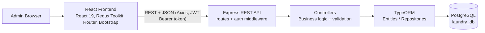

# System Architecture

## Backend layers
| Layer | Folder | Responsibility |
|---|---|---|
| Routes | `backend/src/routes` | Maps URL + HTTP method to a controller; protects routes with JWT |
| Middleware | `backend/src/middleware` | `auth` (JWT check), `asyncHandler`, `errorHandler` |
| Controllers | `backend/src/controllers` | Validation, business rules (total bill, payment rules), responses |
| Entities | `backend/src/entities` | TypeORM table definitions |
| Config | `backend/src/config` | Database connection |

## Frontend layers
| Layer | Folder | Responsibility |
|---|---|---|
| Pages | `frontend/src/pages` | One component per screen |
| Components | `frontend/src/components` | Reusable UI (Layout, ProtectedRoute, Pagination, Loader, ...) |
| Store | `frontend/src/store` | Redux Toolkit slices + async thunks |
| API | `frontend/src/api` | Axios instance (adds token, handles 401) |
| Hooks | `frontend/src/hooks` | `useListQuery` (search/filter/sort/page), `useDebounce` |
